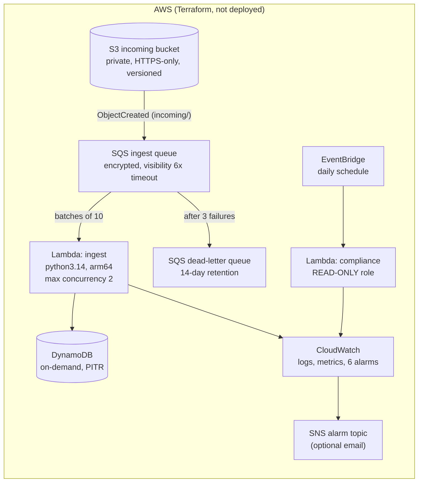

# Serverless Data Pipeline & Security Compliance Engine

> An event-driven AWS pipeline (S3 → SQS → Lambda → DynamoDB, with dead-letter
> handling) plus a Python compliance scanner that detects risky configurations and
> proposes fixes in **dry-run mode by default**.

> **Status: work in progress.** This README separates what is built and tested from
> what is designed but not yet deployed. Nothing below is claimed until it has evidence
> in [`docs/evidence/`](docs/evidence/).

## Project status

| Capability | Status | Evidence |
|---|---|---|
| Lambda processing logic: validation, partial batch failures, idempotent writes | 🧪 Implemented, tested against simulated AWS | [evidence log](docs/evidence/README.md) |
| Retries and dead-letter queue (3 attempts, then DLQ) | 🧪 Tested against simulated AWS | [failure handling](docs/evidence/README.md#failure-handling-demonstrated-by-the-tests) |
| Compliance scanner: 6 rules across S3, EC2 and IAM | 🧪 Implemented, tested against simulated AWS | [demo output](docs/evidence/compliance-demo.txt) |
| Guarded remediation: dry run by default, opt-in tags, allowlist | 🧪 Tested, including a negative-control experiment | [evidence log](docs/evidence/README.md#2026-10-24-compliance-scanner) |
| 49 automated tests, 96% line coverage, lint clean | ✅ Passing locally | [tests.txt](docs/evidence/tests.txt) |
| Terraform (S3, SQS + DLQ, 2 Lambdas, DynamoDB, EventBridge, alarms), statically validated, **not deployed** | ✅ Validated | [terraform-validate.txt](docs/evidence/terraform-validate.txt) |
| IaC security scan (Trivy): 0 unaccepted HIGH/CRITICAL findings | ✅ Scanned | [trivy-scan.txt](docs/evidence/trivy-scan.txt), [triage](#security-scan-triage) |
| GitHub Actions CI | ⏳ Planned | — |
| Real AWS deployment + AWS Config rules | 🗺️ Future | — |

**Legend:** ✅ implemented & verified · 🧪 simulated locally · ⏳ planned for this phase · 🗺️ future enhancement

## How the pipeline works


Diagram status: the flow is **implemented in code and tested against moto**. The AWS
resources themselves are not deployed yet.

1. A CSV of orders is uploaded to S3.
2. S3 sends an event notification to an SQS queue. The queue absorbs bursts and keeps
   messages safe if the function is failing.
3. Lambda receives up to 10 messages at a time, reads each file, and validates every row.
4. Valid orders are written to DynamoDB with a **conditional write**, so a repeated
   delivery never creates or overwrites an order.
5. Each file gets a summary record: `PROCESSED` (with counts and sample row errors) or
   `REJECTED` (with the reason).

### Three levels of error handling

| Problem | Example | What happens |
|---|---|---|
| Bad **row** | Invalid email, negative amount | Row skipped and recorded with its line number; the rest of the file is stored |
| Bad **file** | Not a CSV, missing columns, too large | File marked `REJECTED` once; **not retried**, because retrying cannot fix it |
| **Transient** failure | DynamoDB throttled or unavailable | Message reported as failed; SQS retries it; after 3 attempts it goes to the **DLQ** for investigation and replay |

## Compliance scanner

Most cloud security incidents come from **misconfiguration**: a public bucket, an
internet-facing SSH port, a key that never expires. The scanner reads account settings
(read-only), reports findings, and can fix a small set of them under strict safeguards.

| Rule | Detects | Severity | Automatic fix |
|---|---|---|---|
| S3-001 | Bucket does not fully block public access | HIGH | ✅ Enable all four Block Public Access settings |
| S3-002 | Bucket policy allows non-HTTPS requests | MEDIUM | Manual: editing policies can break clients |
| S3-003 | Versioning disabled | LOW | Manual: changes storage cost |
| EC2-001 | SSH (22) or RDP (3389) open to `0.0.0.0/0` or `::/0` | HIGH | ✅ Revoke only the internet-wide range |
| EC2-002 | All traffic open to the internet | CRITICAL | ✅ Revoke only the internet-wide range |
| IAM-001 | Active access key older than 90 days | MEDIUM | Manual: rotation needs the key owner |

### Safety model

A resource is changed only when **all** of these hold:

1. The rule has an automatic fix (the allowlist above).
2. `--apply` is passed. **The default is a dry run** that only reports what would change.
3. The resource is tagged `compliance:auto-remediate=true`, so owners opt in per resource.
4. It is run by a person through the CLI. The scheduled Lambda entry point can only plan.

Every outcome (`PLANNED`, `APPLIED`, `SKIPPED` with a reason, `FAILED`) is logged as JSON.

```bash
python -m compliance scan                       # read-only; exit 1 if HIGH+ findings
python -m compliance scan --format json --fail-on CRITICAL
python -m compliance remediate                  # dry run: shows the plan
python -m compliance remediate --apply          # changes opted-in resources only
python scripts/demo_compliance.py               # full demo on a simulated account
```

The CLI needs `PYTHONPATH=src` when run from the repository root (`set PYTHONPATH=src` on
Windows cmd, `$env:PYTHONPATH="src"` in PowerShell). Against a real account it uses your
normal AWS CLI credentials and needs read-only permissions for `scan`.

## AWS infrastructure (designed and validated, not deployed)

[`terraform/`](terraform/) defines the whole stack. It passes `terraform validate` and a Trivy
scan, but it has **not been applied to AWS**.



| File | Creates |
|---|---|
| `storage.tf` | Bucket with Block Public Access, owner-enforced (no ACLs), encryption, versioning, HTTPS-only policy, 30-day expiry, and the S3 → SQS notification |
| `queue.tf` | Queue + DLQ, redrive after 3 attempts, and a queue policy that lets **only this bucket in this account** send messages |
| `database.tf` | On-demand table with point-in-time recovery |
| `ingest.tf` | Ingest Lambda, least-privilege role, and the SQS trigger with partial batch responses and capped concurrency |
| `compliance.tf` | Scanner Lambda with a **read-only** role and its daily EventBridge schedule |
| `monitoring.tf` | Alarms: DLQ not empty, backlog > 15 min, failed messages, function errors, HIGH/CRITICAL findings |

### Security design

- **Each function has its own IAM role** with only the actions its code calls, scoped to
  specific resources where AWS allows it.
- **The compliance role is read-only.** The code never applies fixes from Lambda, and the
  permissions make it impossible anyway (defense in depth).
- The bucket meets the same rules the scanner enforces (S3-001, S3-002, S3-003).
- **`s3:ListBucket` on `incoming/` is deliberate:** without it, S3 returns `AccessDenied`
  instead of `NoSuchKey` for a deleted file, and the handler would retry it into the DLQ.

### Security scan triage

Trivy 0.76.1 ([raw output](docs/evidence/trivy-scan.txt)). CI fails on any HIGH or CRITICAL
finding that is not accepted below.

| Finding | Severity | Decision | Reason |
|---|---|---|---|
| AWS-0132: S3 not using a customer-managed KMS key | HIGH | Accepted (inline `trivy:ignore`) | Encrypted at rest with SSE-S3. A KMS key adds cost and key-policy work; justified for regulated data, not demo files |
| AWS-0095: SNS topic not encrypted | HIGH | Accepted (inline) | CloudWatch alarms cannot publish to a topic using the AWS-managed SNS key. Messages hold alarm metadata only |
| AWS-0017 / AWS-0025: logs and DynamoDB use AWS-managed keys | LOW | Accepted | Encrypted at rest; customer keys add cost |
| AWS-0066: no X-Ray tracing | LOW | Future | JSON logs + EMF metrics cover this stage |
| AWS-0089: no S3 access logging | LOW | Future | Needs a separate log bucket |

### Cost (ESTIMATE, not billing data)

Serverless resources cost almost nothing while idle, unlike Project 1's NAT gateway and
load balancer. Approximate us-east-1 list prices; **check the
[AWS Pricing Calculator](https://calculator.aws/) before deploying.**

| Item | Idle cost | Notes |
|---|---|---|
| Lambda, SQS, DynamoDB requests, EventBridge | ~$0 | Charged per request; a demo's volume is tiny |
| S3 + DynamoDB storage | Cents | Files expire after 30 days |
| CloudWatch custom metrics (~11 from EMF) | ~$3/month | Likely the largest item; the free tier covers 10 metrics |
| CloudWatch alarms (6) | ~$0.60/month | |
| **Rough total** | **~$4/month** | Destroy after testing to reach $0 |

### Deploy and tear down (when an AWS account is available)

```bash
cd terraform
terraform init
terraform plan -out tfplan        # review every resource first
terraform apply tfplan
terraform destroy                 # removes everything, including the bucket's files
```

## Run it locally

**Prerequisite:** Python 3.14. No AWS account is needed: tests use moto's simulated AWS.

```bash
python -m venv .venv
.venv\Scripts\activate          # macOS/Linux: source .venv/bin/activate
pip install -r requirements-dev.txt
pytest --cov                    # 49 tests
ruff check . && ruff format --check .
```

## Repository layout

```
src/pipeline/
  handler.py        Lambda entry point: SQS batch -> per-file processing -> batchItemFailures
  records.py        CSV parsing and row validation (pure functions)
  store.py          Idempotent DynamoDB writes and file summaries
  observability.py  JSON logs and CloudWatch Embedded Metric Format
src/compliance/
  checks.py         Read-only detection rules (S3, EC2, IAM)
  scanner.py        Runs all checks; one failing check never stops the others
  remediation.py    Allowlisted fixes behind dry-run, --apply and opt-in tag gates
  cli.py            `python -m compliance scan | remediate [--apply]`
  handler.py        Scheduled Lambda entry point (plans only, never applies)
scripts/
  demo_compliance.py  End-to-end demo against a simulated account
terraform/          AWS infrastructure (validated, not deployed)
tests/
  sqs_driver.py     Stand-in for Lambda's SQS polling, which moto does not provide
  test_records.py   Validation unit tests
  test_pipeline.py  End-to-end tests against simulated S3, SQS and DynamoDB
  test_compliance.py  Scanner and remediation tests on a misconfigured simulated account
docs/evidence/      Real test output and experiment results
```

## Known limitations (current phase)

- Not deployed; tested against moto only. Lambda's real SQS polling, IAM, and limits are untested.
- One DynamoDB write per order (no batching). Fine for files up to the 10,000-row limit,
  but slower for very large files.
- When the same `order_id` arrives in a later file, the first version wins. Updates to
  existing orders are not supported.
- The scanner covers 6 rules in one region per run. S3 account-level Block Public Access,
  CloudTrail, root-account checks, and multi-account scanning are not implemented.
- If one S3 bucket's settings cannot be read (e.g. `AccessDenied`), the whole S3 check is
  reported as an error, rather than skipping just that bucket.

## License

[MIT](LICENSE)
