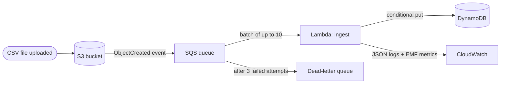

# Serverless Data Pipeline & Security Compliance Engine

> An event-driven AWS pipeline (S3 → SQS → Lambda → DynamoDB, with dead-letter
> handling) plus a Python compliance scanner that detects risky configurations and
> proposes fixes in **dry-run mode by default**.

> **Status: work in progress.** This README separates what is built and tested from
> what is designed but not yet deployed. Nothing below is claimed until it has evidence
> in [`docs/evidence/`](docs/evidence/).

## Project status

| Capability | Status | Evidence |
|---|---|---|
| Lambda processing logic: validation, partial batch failures, idempotent writes | 🧪 Implemented, tested against simulated AWS | [evidence log](docs/evidence/README.md) |
| Retries and dead-letter queue (3 attempts, then DLQ) | 🧪 Tested against simulated AWS | [failure handling](docs/evidence/README.md#failure-handling-demonstrated-by-the-tests) |
| 35 automated tests, 99% line coverage, lint clean | ✅ Passing locally | [pipeline-tests.txt](docs/evidence/pipeline-tests.txt) |
| Compliance scanner (detect + dry-run remediation) | ⏳ Planned | — |
| Terraform (S3, SQS, Lambda, DynamoDB, alarms), validated but not deployed | ⏳ Planned | — |
| GitHub Actions CI | ⏳ Planned | — |
| Real AWS deployment + AWS Config rules | 🗺️ Future | — |

**Legend:** ✅ implemented & verified · 🧪 simulated locally · ⏳ planned for this phase · 🗺️ future enhancement

## How the pipeline works



Diagram status: the flow is **implemented in code and tested against moto**. The AWS
resources themselves are not deployed yet.

1. A CSV of orders is uploaded to S3.
2. S3 sends an event notification to an SQS queue. The queue absorbs bursts and keeps
   messages safe if the function is failing.
3. Lambda receives up to 10 messages at a time, reads each file, and validates every row.
4. Valid orders are written to DynamoDB with a **conditional write**, so a repeated
   delivery never creates or overwrites an order.
5. Each file gets a summary record: `PROCESSED` (with counts and sample row errors) or
   `REJECTED` (with the reason).

### Three levels of error handling

| Problem | Example | What happens |
|---|---|---|
| Bad **row** | Invalid email, negative amount | Row skipped and recorded with its line number; the rest of the file is stored |
| Bad **file** | Not a CSV, missing columns, too large | File marked `REJECTED` once; **not retried**, because retrying cannot fix it |
| **Transient** failure | DynamoDB throttled or unavailable | Message reported as failed; SQS retries it; after 3 attempts it goes to the **DLQ** for investigation and replay |

## Run it locally

**Prerequisite:** Python 3.14. No AWS account is needed: tests use moto's simulated AWS.

```bash
python -m venv .venv
.venv\Scripts\activate          # macOS/Linux: source .venv/bin/activate
pip install -r requirements-dev.txt
pytest --cov                    # 35 tests
ruff check . && ruff format --check .
```

## Repository layout

```
src/pipeline/
  handler.py        Lambda entry point: SQS batch -> per-file processing -> batchItemFailures
  records.py        CSV parsing and row validation (pure functions)
  store.py          Idempotent DynamoDB writes and file summaries
  observability.py  JSON logs and CloudWatch Embedded Metric Format
tests/
  sqs_driver.py     Stand-in for Lambda's SQS polling, which moto does not provide
  test_records.py   Validation unit tests
  test_pipeline.py  End-to-end tests against simulated S3, SQS and DynamoDB
docs/evidence/      Real test output and experiment results
```

## Known limitations (current phase)

- Not deployed; tested against moto only. Lambda's real SQS polling, IAM, and limits are untested.
- One DynamoDB write per order (no batching). Fine for files up to the 10,000-row limit,
  but slower for very large files.
- When the same `order_id` arrives in a later file, the first version wins. Updates to
  existing orders are not supported.

## License

[MIT](LICENSE)
